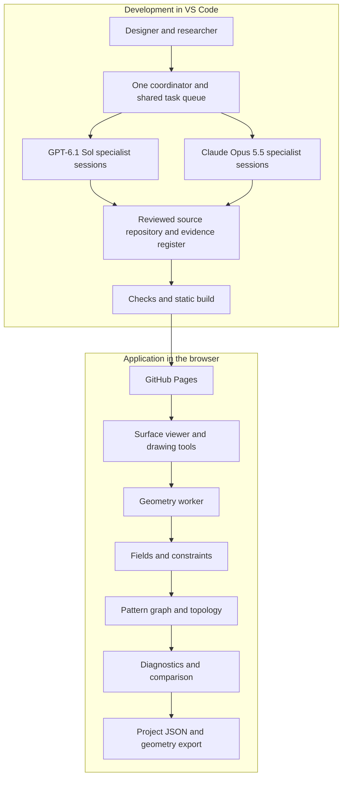

# Knit Topology Lab — scientific and artistic development blueprint

Prepared 6 November 2026. Product and workflow recommendations are proposed engineering choices. External research is identified by source IDs, with access limitations recorded in `research/sources.csv`.

## 1. The project we are actually building

Build a machine-agnostic, browser-based environment for generating, drawing, editing, comparing and exporting patterns and topology on surfaces. Host the application on GitHub Pages. Use GPT-6.1 Sol and Claude Opus 5.5 in VS Code to develop and review it. CAD plugins, knitting-machine backends and physical fabrication are later extensions.

The design space includes load-oriented patterns, multiple resolutions, directional flow, graphic-statics-inspired networks, reaction-diffusion, curvature adaptation, sketch-guided retopology, multilayer pockets, and constrained surface-area exploration.

The first release produces geometric patterns and explicitly defined topology. It should distinguish:

1. **Surface pattern:** curves, cells, scalar fields and direction fields on a surface.
2. **Textile topology:** proposed courses, wales, loop relationships, layers, joins and openings, when actually represented.
3. **Machine program:** a scheduled sequence of operations for identified hardware. This is outside the first release.

A quad mesh is not automatically a stitch graph; a stitch graph is not automatically machine-knittable. The staged translation in automatic-knitting research motivates keeping these representations separate [S13, S23].

Load intent is part of a design record: tension, compression, mixed loading, nonstructural surface, pocket, flow or area. A label records the designer's goal. A mechanically verified result additionally needs defined material behavior, supports, loads, solution checks and validation evidence.

## 2. Two systems, with a clean boundary



GitHub Pages serves static files [S09]. Make the first app run locally in the browser without a server or AI account. GPT and Claude are development collaborators, not required for each pattern-generation operation.

If you later add a live AI assistant to the website, design a separate authenticated service. A static JavaScript bundle cannot keep a provider API key secret; putting a key in build-time environment variables does not solve that if the key reaches the bundle. Do not add that infrastructure to the first geometry prototype.

## 3. Recommended software architecture

Use **TypeScript + React + Vite + Three.js**. This is a recommended starting stack, not a scientific finding. Use Three.js for viewing and surface picking [S11], with numerical algorithms in independent modules. Send expensive calculations to a Web Worker [S12]. Introduce WebAssembly only after profiling identifies a specific need.

Proposed application modules:

```text
src/
  app/                  controls, workspace and comparison UI
  viewer/               rendering, selection and surface strokes
  core/
    geometry/           meshes, adjacency, tangent frames and geometry checks
    fields/             spacing, directions, curvature and diffusion
    patterns/           strategies producing curves and cell networks
    topology/           graph edits, layers, joins and openings
    diagnostics/        numerical and topology reports
    project/            versioned project serialization and migrations
  workers/              cancellable jobs and progress messages
  adapters/             geometry import/export; later CAD and machine adapters
tests/
  fixtures/             analytic surfaces, problematic meshes and graph cases
  numerical/            invariants, convergence and reference comparisons
  browser/              drawing, save/load and Pages-path smoke checks
```

Keep `core` independent of React, the DOM and Three.js scene objects. Use typed arrays and explicit units. This lets a future CAD plugin reuse the kernel through a thin adapter instead of copying algorithms from the UI.

Maintain numerical coordinates separately from rendering buffers when precision requires it. Treat the scene as a view of the project, not the only copy of the project. Do not use a screenshot or GLB alone as the scientific record: neither captures all fields, topology semantics and provenance.

Save a versioned project JSON containing geometry references or embedded geometry, surface revisions, field definitions, graph topology, operations, seed, algorithm versions, diagnostics and evidence links. Export OBJ/GLB for geometry and SVG for suitable 2D curves as additional outputs. Include units and coordinate conventions; OBJ alone has no reliable unit contract.

## 4. The agent workforce

An agent becomes useful through a narrow responsibility, good tools, reference material, and demonstrated performance on representative tasks. A prompt calling it a world expert is not evidence of expertise. Start without fine-tuning; build a benchmark set and improve the instructions from observed failures.

Use ten roles, activating only the ones a task needs:

| Role | Responsibility | Expected result |
|---|---|---|
| Coordinator | Scope, task dependencies, interfaces, integration and budget | Prioritized task packet and integrated decision |
| Research librarian | Primary-source discovery, claims, assumptions and counterevidence | Evidence cards with applicability limits |
| Geometry specialist | Mesh repair, adjacency, surface coordinates and curvature | Tested geometry routines and diagnostics |
| Field specialist | Tangent line fields, spacing metrics, tracing and diffusion | Reproducible fields with numerical checks |
| Topology specialist | Connectivity, retopology, layers, pockets and textile semantics | Editable graph plus topology invariants |
| Mechanics specialist | Load cases, equilibrium, constitutive assumptions and interpretation | Explicit model or evidence-limited interpretation |
| Textile specialist | Course/wale semantics, topology plausibility and future compiler boundary | Feasibility assumptions and unsupported operations |
| Interaction specialist | Surface drawing, navigation, undo, comparison and browser performance | Usable, responsive editing workflow |
| Validation specialist | Independent reference checks, regression cases and claim audit | Reproduction steps and substantive findings |
| Art director | Expressive families, controlled variation and design critique | Distinct, reproducible alternatives with stated intent |

**Suggested initial routing:** GPT-6.1 Sol as coordinator and implementation worker; Claude Opus 5.5 as research and independent review lead. Both can perform any role. This is an initial work allocation, not a claim that one provider is inherently scientific or artistic. Compare them on the same project tasks and swap assignments when the evidence favors it.

The documented model IDs are `gpt-6.1-sol` [S01] and `claude-opus-5-5` on the direct Claude API [S02]. Select the requested models where your account supports them. Log the model ID actually used, client version, effort setting when applicable, time and cost. Do not silently substitute a model.

This kit contains nine native specialist profiles for each provider plus a coordinator charter. Codex uses project `.codex/agents/*.toml` [S05]; Claude Code uses `.claude/agents/*.md` [S06]. Each provider's native profile uses that provider's requested model. A Codex subagent profile is not a cross-provider Claude launcher. Use the shared task/handoff contract to coordinate the two systems.

## 5. How to orchestrate without creating confusion

### Start with a supervised workflow in VS Code

1. Open the project with both official extensions [S03, S04]. Choose the requested model in each client.
2. Keep one coordinator session. Let it define small tasks in `tasks/queue.json`, using `templates/task.json`.
3. Give each implementation task its own branch and worktree, or serialize edits in a single checkout. Assign file ownership; two active workers should not edit the same file.
4. Run up to two independent workers initially. Review can be a later step. The included Codex cap is three spawned threads, but this does not enforce a combined limit across providers.
5. Send a task packet to the chosen provider. Native subagents within that provider can handle bounded subtasks. The coordinator records cross-provider results through a handoff file or returned patch.
6. Have the other provider review important algorithmic changes against the specification and reference cases. Give it the assumptions and evidence, not a demand to agree with the author.
7. Integrate only after the relevant checks pass. Record unresolved disagreements as testable questions, not votes.

For the first prototype, a human can relay the task packets between the two extensions. That is coordinated development, not fully automated cross-provider orchestration. Do not describe it as automatic until a dispatcher really exists.

### Automate the proven workflow later

If task volume makes manual handoffs burdensome, build one small local dispatcher with persistent task state. A plain scheduler may be sufficient; LangGraph is an option when conditional routing, checkpoints and resume behavior justify it [S24]. Use documented provider clients or coding-agent SDKs and recheck their current interfaces when implementing.

The dispatcher should:

- Claim one task atomically and assign one owner; record dependency revisions and output paths.
- Route to either provider through separate adapters; normalize task results, not undocumented tool internals.
- Run deterministic geometry jobs outside the language-model loop.
- Save progress, artifact hashes and failures so a restart does not lose the experiment.
- Enforce a global concurrency limit, per-task time/token budget, cancellation and bounded retries.
- Return schema changes or unresolved scientific assumptions to the coordinator; escalate to the user only when a real product decision is needed.

Suggested starting controls are two active workers, at most two repair attempts per failed task, and a user-chosen spending ceiling. These are adjustable operating choices. A retry of a tool with side effects needs an idempotency strategy; geometric calculations should ideally be pure functions.

Keep completion messages short: result, changed artifacts, checks, uncertainty, next dependency. Avoid repeated role introductions, agent-to-agent debates and constant progress noise. Expand the team only when parallel work measurably helps.

## 6. The common data model is the central design decision

All strategies should speak a shared language:

| Object | Meaning | Important metadata |
|---|---|---|
| Surface | Indexed mesh and chart/patch identity | Units, orientation, boundaries, revision |
| Scalar field | Spacing, density, curvature or diffusion value | Domain, units, sampling method, range |
| Tangent line field | Preferred undirected orientation | Surface frame, confidence, singularities |
| Tensor/metric field | Direction-dependent target spacing or measured/solved mechanical tensor | Tensor type, units, basis, load case |
| Constraint | Drawing, seam, opening, alignment or protected feature | Hard/soft status, weight, region and provenance |
| Pattern graph | Nodes, edges and cells with stable identity | Surface attachment, adjacency, feature meaning |
| Textile topology | Additional loop/course/wale/layer relationships when defined | Construction assumptions and unsupported cases |
| Diagnostic | A specific measured or computed check | Method, units, tolerance and result |
| Claim | A statement about behavior | Evidence class, source, assumptions and limits |

Do not mix a geometric spacing metric with a stress tensor merely because both can be stored as matrices. Do not average incompatible units. Do not average direction vectors with arbitrary signs: a line direction `d` and `-d` represent the same orientation. Transport directions into compatible tangent frames before comparing them.

Cross fields can assist quadrilateral remeshing, but course and wale directions usually need distinct labels and potentially different spacings. A 90-degree rotationally symmetric field can discard that distinction. Make the choice explicit.

For surface drawing, store stroke samples using face IDs and barycentric coordinates tied to a surface revision. Use projected tangent constraints, not just screen coordinates. When the base mesh changes, transfer or invalidate those attachments explicitly.

The first reliable strategy interface should be approximately:

`surface + fields + constraints + parameters + seed -> pattern graph + diagnostics + provenance`

Topology-changing strategies may also return new layers, patch relations and surface revisions. They must not silently rewrite upstream geometry.

## 7. Pipeline and acceptance gates

### Stage A — Define a question

Choose one output and a measurable question. Example: “Can a surface-drawn guide orient a cell network on a saddle while preserving one pocket opening and a minimum feature width?” Record which requirements are hard constraints and which are preferences.

**Pass:** the result can be judged without relying only on whether it looks attractive. Artistic criteria can remain qualitative, but name them: rhythm, variation, legibility, continuity or contrast.

### Stage B — Prepare and diagnose the surface

Load or generate a surface; establish scale, orientation, boundaries, components and degeneracies. Preserve intentional holes. Detect invalid input before calculating curvature or tracing curves.

**Pass:** the downstream algorithm's requirements are met, or unsupported regions are identified. Do not force a universal closed-manifold rule on a design that deliberately has openings or multiple layers.

### Stage C — Generate evidence-labeled fields

Create curvature, drawing, spacing, diffusion or supplied mechanical fields. Store each field's origin and assumptions. Imported stress data must retain its material, geometry revision, basis, units and load case.

**Pass:** fields have finite values, appropriate units, a defined surface attachment and numerical checks. Undefined directions near flat, isotropic or singular regions are handled deliberately.

### Stage D — Compose constraints

Combine preferred flow, spacing, protected features and artistic edits. Normalize compatible objectives, retain hard constraints, and report conflicts. Present a few named tradeoffs or a Pareto comparison rather than one unexplained “optimal” result.

**Pass:** the designer can see which criteria were met and which competed. Constraint weights are recorded and do not imply scientific meaning by themselves.

### Stage E — Construct patterns and topology

Trace, partition or remesh using the fields; create explicit connectivity. Keep geometric curve intersections separate from intentional graph junctions. For pockets, represent layers, joined boundaries and openings. Add textile semantics only where the representation supports them.

**Pass:** connectivity, boundaries, self-intersection policy and feature-size constraints match the intended object. Any manufacturability status remains qualified until a later compiler exists.

### Stage F — Inspect and compare

Compare variants using the same surface, parameter budget and diagnostic definitions. Show projected curves, graph connectivity, spacing variation, singularities, pocket openings and numerical failures as selectable overlays. Keep the normal design flow simple; detailed evidence belongs in an inspectable panel and export.

**Pass:** a user can distinguish an appearance change from a connectivity change, and a physically derived field from an artistic field.

### Stage G — Save and reproduce

Save the full project and export selected outputs. Repeat a deterministic run with the same inputs, seed and implementation version. For numerical solvers, document tolerances; do not promise bit-identical results across all browsers or future GPU implementations.

**Pass:** a fresh session recovers the intended graph and metadata; geometry and topology round-trip within defined tolerances.

### Stage H — Add physical and manufacturing validation later

For a specific material system, measure swatches and assemblies, calibrate a model, validate on held-out cases, and then assess relevant designs. Add a machine capability profile and compiler as an adapter when fabrication becomes the objective.

**Pass:** predictions agree with independent observations within declared uncertainty and use limits. Rendering, equilibrium, material validation and machine scheduling are different checks.

## 8. Your pattern families, translated into implementable strategies

| Family | First useful implementation | Scientific or geometric issue |
|---|---|---|
| Form and force paths | Import a field or define explicit load/support cases; trace preferred tangent directions | A curve resembling a force path has no equilibrium proof. Changing material orientation can change the field, requiring iteration. |
| Multiple scales and resolutions | Separate display tessellation, pattern spacing and textile cell scale; use a spatial spacing field | More display triangles do not mean more stitches or higher material resolution. Smooth transitions need topological handling. |
| Vector-flow divisions | Surface-tangent line fields, streamline tracing, separatrices and patch decomposition | Handle sign ambiguity, singularities, intersections and nonintegrable target grids. |
| 3D graphic-statics-like networks | Begin with an explicit equilibrium network or an expressive network with an honest label | Reciprocal form/force diagrams belong to a structural model [S20]; they are not interchangeable with a knitted membrane. |
| Natural diffusion patterns | Seeded surface reaction-diffusion, then contours or region boundaries | Use the surface metric; a flat UV texture may distort wavelengths. Pattern synthesis is not mechanical optimization [S19]. |
| Curvature adaptation | Estimate principal curvatures; derive target spacing with bounds; compare to uniform spacing | Curvature is not stress. Direction estimates become unstable near equal principal curvatures and noisy data. |
| Draw-on-surface retopology | Project strokes, make tangent constraints, solve a field, partition patches, create an editable graph | Projecting drawn lines is only the input step. Field-aligned remeshing is useful precedent [S18]; knitting adds constraints. |
| Pockets and multilayers | Explicit layer patches, join edges and opening loops with interactive edits | A bump or displacement map is not a pocket. Double layers need distinct topological identities. |
| Surface-area exploration | Optimize a defined area objective under an envelope, material budget and minimum feature size | Unconstrained area maximization is ill-posed. Wrinkles, intersections and tiny features can inflate the result. |

For area work, define whether you mean material mid-surface area, projected coverage, accessible external area, enclosed volume or yarn surface area. These are different objectives. State how hidden or overlapping layers count. Re-tessellating the same shape should not improve its score except by reducing approximation error.

For textile resolution, a geometric generator may offer arbitrary spacing. A future fixed-gauge machine cannot necessarily realize it. Needle selection, stitch length, shaping and panelization have different consequences. Preserve target dimensions as design intent instead of claiming a universal stitch count.

## 9. Scientific rigor that helps the design work

Maintain an evidence ladder:

- **Design intent:** desired behavior or visual expression.
- **Geometric result:** properties measured from the generated geometry/topology.
- **Model result:** computed from a stated mathematical or mechanical model.
- **Physically validated result:** compared with relevant independent measurements.
- **Manufacturing-validated result:** successfully produced with identified hardware/material/settings.

These are attributes of particular claims, not a single badge that makes an entire design “scientific.” A design can contain a validated geometric area and an untested compression hypothesis at the same time.

For every important scientific statement, record the question, primary source, exact relevant location when available, assumptions, units, scope, conflicting evidence, and the experiment or calculation that would disprove it. Record an abstract-only reading as abstract-only. Do not let an agent invent a page number, DOI, material constant or missing test result.

Use primary papers, author-maintained code, official numerical documentation and, later, the relevant machine manuals. Use summaries and tutorials as discovery aids. Older research can be foundational; age alone does not determine validity. Test research code before adopting it, since an accessible repository is not evidence of current compatibility.

Separate **verification** (“did we implement the equations correctly?”) from **validation** (“do those equations adequately describe this material and experiment?”). Two language models agreeing does neither by itself.

For geometry, compare plane/sphere/cylinder/saddle cases, check coordinate invariance, boundaries and mesh refinement. For diffusion, check constant-field behavior where applicable, boundary conditions, time-step behavior and mesh dependence. For topology, check actual adjacency, intended components, openings, orientation and forbidden intersections.

For mechanics, later define material architecture, tension/compression conventions, prestress, supports, contact, load history and constitutive behavior. Membrane forces in N/m and stress in Pa must not be conflated. A line network, membrane and shell need different models. Equilibrium residuals alone do not establish stability, buckling resistance, strength or serviceability.

Knitted material response is affected by topology and yarn geometry [S15, S16]. Do not assume an isotropic linear elastic material across large deformations, changing stitch families or loading histories. Use calibrated continuum models at assembly scale and detailed yarn models only where they answer a specific question.

For **compression**, determine what resists it: confinement, stacking, bending-stiff layers, pressure, reinforcement, coating, a composite matrix, or another stabilizing mechanism. A loose sheet can wrinkle or buckle. The relevant compression mode may be through-thickness rather than in-plane. The app should ask for that distinction before offering a quantitative compression result.

KnitCandela is an important architectural precedent, but its knitted formwork, load-bearing cable net and final concrete shell served different structural roles [S17]. Do not transfer the finished shell's behavior to an unsupported knitted textile.

## 10. The first release, in dependency order

### Milestone 1 — One complete vertical slice

Create a plane and saddle, orbit/select/draw on them, generate one direction-guided pattern, adjust spacing, inspect connectivity, undo a change, and save/reload the project. Include a cancellable worker and an unambiguous unit convention.

**Exit:** a repeatable browser demonstration and matching saved project, with graph validation and no model-service dependency. This is the highest-value first build.

### Milestone 2 — Controlled variation

Add curvature-adaptive spacing and a multi-resolution strategy. Compare against a uniform baseline using the same geometry and feature budget. Record algorithm settings and seed.

**Exit:** geometrically explainable differences and numerical tests, not just new visual presets.

### Milestone 3 — Organic patterns

Add surface diffusion and contour/region extraction. Keep scalar pattern generation separate from graph extraction so either stage can be inspected.

**Exit:** reproducible patterns, explicit boundary handling and convergence evidence appropriate to the implemented scheme.

### Milestone 4 — Editable topology and pockets

Add explicit joins, cuts, openings and layer relationships. Provide a tiny library of valid and deliberately invalid topology examples. Prototype course/wale annotations without promising machine scheduling.

**Exit:** graph semantics survive edits, undo and save/load. An intended pocket remains open at the specified boundary.

### Milestone 5 — Structurally informed exploration

Import supplied load cases and mechanical fields with provenance; optionally implement a narrow verified equilibrium example. Keep graphic statics and surface material analysis as distinct modules. Add bounded area objectives.

**Exit:** every mechanical display states its model and assumptions; no decorative field is labeled as validated performance.

### Milestone 6 — Release to GitHub Pages

Run geometry/topology checks, build, and browser smoke checks under the repository subpath. Configure Vite's base path and Pages deployment using the current official guidance [S10]. Avoid server-only routes; use a single-page state model or hash routing if routing is needed.

**Exit:** loading, worker execution, file save/load and assets work from the deployed repository URL. Publish only when the user requests that release action in the implementation project.

### Later

Add calibrated mechanics, richer textile topology, material experiments, CAD adapters and machine compilation in response to demonstrated needs. Keep material and machine capability profiles separate from the geometry kernel. Knit Sketching [S14], Autoknit [S13, S25] and Knitout [S23] are references for that later stage, not drop-in guarantees for every textile architecture.

## 11. Tools and skills worth adding

**Use now:** both official coding clients in VS Code, Git and isolated branches, TypeScript/React/Vite/Three.js, Web Workers, a numerical test runner, browser smoke tests, project JSON, a small primary-source register, and the six scoped skills included here.

**Use when justified:** an offline Python/NumPy/SciPy research environment for reference calculations, COMPAS for architectural geometry and form-finding studies [S21], libigl for reference geometry algorithms [S22], and a local persistent task dispatcher [S24]. Verify package/runtime compatibility before installing; none is assumed to run inside GitHub Pages.

**Defer:** large agent swarms, fine-tuning, a vector database for a tiny literature set, full yarn simulation of architectural assemblies, simultaneous competing coordinators, automated machine control, CAD plugins, and an embedded AI chat service. Revisit each when it solves a measured problem.

Included reusable skills:

1. `knit-evidence-review` — convert sources into bounded claims and research decisions.
2. `surface-field-design` — generate and combine surface fields with consistent semantics.
3. `textile-topology-design` — design graph connectivity, layers and openings without conflating it with scheduling.
4. `geometry-verification` — choose analytic/reference cases and numerical checks.
5. `expressive-pattern-exploration` — generate controlled, comparable artistic variants.
6. `static-geometry-webapp` — preserve the browser/kernel boundary and GitHub Pages compatibility.

## 12. Decisions to settle while building

The existing brief is enough to start Milestone 1. Resolve these questions when their answers affect a task:

- Is the primary editable output a cell mesh, a curve network, a knit-semantic graph, or several synchronized views?
- Are course and wale directions required for the first strategy, or will they be annotations added after geometric exploration?
- What does “flow” mean in each preset: visual direction, material direction, stress direction or fluid movement?
- What area is being maximized, under which envelope and material budget?
- What is the intended compression mechanism and loading direction?
- Which imported surface formats and approximate mesh sizes matter first?
- Which artistic decisions should remain deliberately under direct user control?

Use small prototypes to answer these questions. Do not build a general optimizer or a full mechanics system before the underlying object and objective are clear.

## 13. First task to give the coordinator

> Read AGENTS.md, the project brief, the coordinator charter and this blueprint. Treat the application as a static browser-based pattern/topology explorer for GitHub Pages. Plan and implement only Milestone 1. Use GPT-6.1 Sol and Claude Opus 5.5 through the documented local clients, with explicit task packets across providers. Establish the data model before parallel implementation. Run at most two workers, give each separate files or worktrees, and return concrete artifacts and checks. Produce a plane/saddle example with surface drawing, one guided pattern, spacing control, graph diagnostics, undo and project save/load. Keep machine compilation, CAD plugins and structural performance claims outside this milestone. Identify unresolved assumptions without blocking independent progress.

## Sources

The source register records verification date, source type, relevance and access limits. Full-text failure is not represented as a full-paper review.


- **S01** — [GPT-6.1 Sol model](https://developers.openai.com/api/docs/models/gpt-6.1-sol). OpenAI. Model identifier and supported API; does not establish account access.
- **S02** — [Models overview](https://platform.claude.com/docs/en/models/overview). Anthropic. Claude Opus 5.5 model identifier; provider-specific IDs differ.
- **S03** — [Codex IDE extension](https://learn.chatgpt.com/docs/codex/ide). OpenAI. VS Code integration and local workflow.
- **S04** — [Claude Code in VS Code](https://code.claude.com/docs/en/vs-code). Anthropic. Claude development integration.
- **S05** — [Subagents](https://learn.chatgpt.com/docs/agent-configuration/subagents). OpenAI. Project agent TOML files and inherited provider/permissions.
- **S06** — [Create custom subagents](https://code.claude.com/docs/en/sub-agents). Anthropic. Project agent Markdown, model selection and worktree option.
- **S07** — [Build skills](https://learn.chatgpt.com/docs/build-skills). OpenAI. Project skills in .agents/skills.
- **S08** — [Extend Claude with skills](https://code.claude.com/docs/en/skills). Anthropic. Project skills in .claude/skills.
- **S09** — [What is GitHub Pages?](https://docs.github.com/en/pages/getting-started-with-github-pages/what-is-github-pages). GitHub. Static hosting; browser application architecture.
- **S10** — [Deploying a Static Site](https://vite.dev/guide/static-deploy). Vite. Repository base path and GitHub Actions deployment.
- **S11** — [Raycaster](https://threejs.org/docs/pages/Raycaster). Three.js. Surface picking primitive, not a retopology algorithm.
- **S12** — [Using Web Workers](https://developer.mozilla.org/en-US/docs/Web/API/Web_Workers_API/Using_web_workers). MDN. Background computation and worker communication.
- **S13** — [Automatic Machine Knitting of 3D Meshes](https://textiles.cs.cmu.edu/publications/2018-autoknit/). Narayanan et al. (2018). Geometry-to-knitting pipeline under the paper's machine and topology assumptions.
- **S14** — [Knit Sketching: from Cut & Sew Patterns to Machine-Knit Garments](https://knitsketching.csail.mit.edu/). Kaspar et al. (2021). Annotated sketches and local knitting direction; garment setting.
- **S15** — [Geometry and Elasticity of a Knitted Fabric](https://doi.org/10.1103/PhysRevX.8.021075). Poincloux, Adda-Bedia and Lechenault (2018). Stockinette geometry/elasticity under stated assumptions; not a universal constitutive law.
- **S16** — [Programming mechanics in knitted materials, stitch by stitch](https://pmc.ncbi.nlm.nih.gov/articles/PMC10960873/). Singal et al. (2024). Stitch topology affects mechanical response; experimental and modeling scope must be retained.
- **S17** — [Structural design, digital fabrication and construction of the cable-net and knitted formwork of the KnitCandela concrete shell](https://doi.org/10.1016/j.istruc.2020.02.013). Popescu et al. (2021 volume; online 2020). Architectural knitted formwork; separate cable-net and finished concrete roles.
- **S18** — [Instant Field-Aligned Meshes](https://rgl.epfl.ch/publications/Jakob2015Instant). Jakob et al. (2015). Field-aligned geometric remeshing, not knitting feasibility.
- **S19** — [Generating Textures on Arbitrary Surfaces Using Reaction-Diffusion](https://sites.cc.gatech.edu/gvu/people/faculty/greg.turk/reaction_diffusion/reaction_diffusion.html). Greg Turk (1991). Surface pattern synthesis, not structural optimization.
- **S20** — [compas_3gs](https://github.com/BlockResearchGroup/compas_3gs). Block Research Group. Polyhedral graphic statics; inspect compatibility before reuse.
- **S21** — [Introduction](https://compas.dev/compas/latest/userguide/introduction.html). COMPAS. Useful offline architecture/geometry ecosystem; not a browser dependency by default.
- **S22** — [Tutorial](https://libigl.github.io/tutorial/). libigl. Reference implementations for geometry processing; later WASM port requires engineering.
- **S23** — [Knitout specification](https://textiles-lab.github.io/knitout/knitout.html). Carnegie Mellon Textiles Lab. Low-level knitting IR for a later compiler; machine backends still needed.
- **S24** — [LangGraph persistence](https://docs.langchain.com/oss/python/langgraph/persistence). LangChain. Optional local development orchestrator with persistent checkpoints.
- **S25** — [Autoknit reimplementation](https://github.com/textiles-lab/autoknit). Carnegie Mellon Textiles Lab. Study and benchmark a later compiler; not assumed to run in the browser.
